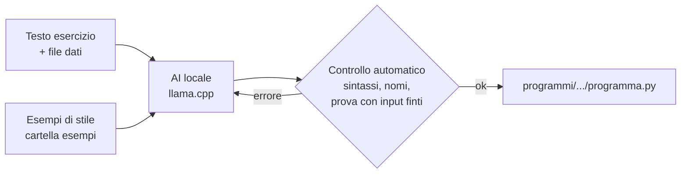

# 🤖 AI Python Offline – l'AI per gli esercizi di Python che sta su una chiavetta

Inserisci la chiavetta in un PC → doppio clic → incolli l'esercizio → ricevi il programma Python.
**Niente internet, niente installazioni, tutto resta sulla chiavetta.**

## 🚀 Come si usa

| Passo | Cosa fare | Quando |
|---|---|---|
| 1️⃣ | Scarica questo repository (**Code → Download ZIP**) e copia **il contenuto** della cartella `chiavetta` nella chiavetta | una volta |
| 2️⃣ | Doppio clic su **`PREPARA_CHIAVETTA.bat`** (serve internet, scarica ~8-9 GB) | una volta |
| 3️⃣ | Su qualsiasi PC: doppio clic su **`AVVIA_AI.bat`**, incolla l'esercizio, premi INVIO su una riga vuota | ogni volta |

Istruzioni complete e semplici: [`chiavetta/LEGGIMI.txt`](chiavetta/LEGGIMI.txt)

## ⚙️ Come funziona



- 🧠 **Sceglie il modello da solo** in base alla RAM libera del PC
- 🎨 **Copia il tuo stile** dagli esempi nella cartella `chiavetta/esempi`
- 🔍 **Prova il programma da sola** e, se trova errori, lo fa correggere (max 2 volte)
- 📊 **File Excel** convertiti in CSV automaticamente
- ⚡ **Cache sulla chiavetta**: dalla seconda volta parte più veloce

## 🧠 Modelli

| Nome | Modello | File | Quando viene usato |
|---|---|---|---|
| `grande` | Qwen2.5-Coder 7B (Q4_K_M) | ~4,7 GB | PC con almeno ~5,6 GB di RAM libera |
| `medio` | Qwen3.5 4B (Q4_K_M) | ~2,7 GB | PC con almeno ~3,4 GB liberi |
| `piccolo` | Qwen2.5-Coder 1.5B (Q4_K_M) | ~1 GB | PC da 4 GB |

Si può forzare un modello in `chiavetta/sistema/app/config.json` (`"modello": "grande"`).

## 📁 Cosa c'è nella chiavetta

```
AVVIA_AI.bat              ← per usarla
PREPARA_CHIAVETTA.bat     ← la prima volta (internet)
LEGGIMI.txt
esempi/                   ← i tuoi esempi di stile (istruzioni.txt + programma.py)
dati/                     ← (facoltativo) file per gli esercizi
programmi/                ← qui vengono salvati i programmi
sistema/
   app/                   ← il programma (assistente.py, prepara.py, stile.txt, config.json)
   python/  llama-win/  llama-linux/  modelli/   ← scaricati da PREPARA_CHIAVETTA
```

## 📝 Note sugli esempi

Gli esempi nella cartella `chiavetta/esempi` sono le versioni **corrette e complete** degli esercizi
che si trovano nelle cartelle originali del repository (lo stile è lo stesso: script dall'alto in basso,
commenti in italiano, dictionary con `if chiave in conteggio`, ecc.). I file originali non sono stati toccati.
